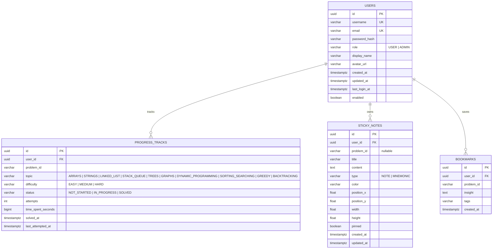

# Think2Code : User Auth, Progress & Personalization Module

A comprehensive, production-grade module for a Data Structures & Algorithms (DSA) learning platform, featuring:
- **JWT Authentication & RBAC**: Access + refresh tokens, BCrypt password hashing, stateless sessions, role-based method security (`USER`, `ADMIN`).
- **Normalized Data Architecture**: PostgreSQL/H2 compatible schema managed via Flyway migrations (`V1__init_schema.sql`, `V2__seed_dev_data.sql`).
- **Personalized Analytics Engine**: Real-time problem attempts tracking, streak evaluations (active and longest streaks), per-topic mastery percentages, and a 30-day activity series.
- **Interactive Sticky Notes & Mnemonics Overlay**: Floating draggable workspace overlay across the entire application with custom drag physics, color-picker, pin/unpin, minimize, distinct MNEMONIC badges, and debounced backend position updates (`PATCH /api/notes/{id}/position`).
- **Insights & Bookmarks Management**: Save key algorithmic insights and searchable tags with one-click drill-down.

---

## 🛠 Tech Stack

### Backend
- **Language & Framework**: Java 17, Spring Boot 3.2.5, Spring Security 6, Spring Data JPA (Hibernate 6)
- **Auth**: JJWT 0.12.5 (Access + Refresh tokens), BCrypt password encoder
- **Database & Migrations**: PostgreSQL (runtime driver), H2 (in-memory dev/test), Flyway 9.x
- **Documentation**: SpringDoc OpenAPI 2.5.0 / Swagger UI 3
- **Testing**: JUnit 5, Mockito, Spring Security Test, MockMvc

### Frontend
- **Framework & Tooling**: React 18, Vite 5, React Router v6
- **Styling**: Tailwind CSS 3, PostCSS, Glassmorphism design system
- **State & Data**: Context API (`AuthContext`, `NotesContext`), Axios with automatic 401 JWT refresh queue
- **Forms & Validation**: React Hook Form, Zod schema validation
- **Visualization**: Recharts (Bar charts, Donut charts, Area charts)
- **Icons**: Lucide React

---

## 🗂 Project Directory Structure

```
dsa-platform/
├── backend/
│   ├── pom.xml
│   ├── .env.example
│   └── src/
│       ├── main/
│       │   ├── java/com/dsaplatform/
│       │   │   ├── DsaPlatformApplication.java
│       │   │   ├── config/
│       │   │   │   └── OpenApiConfig.java
│       │   │   ├── controller/
│       │   │   │   ├── AuthController.java
│       │   │   │   ├── UserController.java
│       │   │   │   ├── ProgressController.java
│       │   │   │   ├── StickyNoteController.java
│       │   │   │   └── BookmarkController.java
│       │   │   ├── dto/
│       │   │   │   ├── auth/ (LoginRequest, RegisterRequest, AuthResponse, RefreshTokenRequest)
│       │   │   │   ├── user/ (UserProfileResponse, UpdateProfileRequest)
│       │   │   │   ├── progress/ (RecordAttemptRequest, ProgressSummaryResponse, TopicStatsDto, DifficultyStatsDto, DailyActivityDto)
│       │   │   │   ├── note/ (StickyNoteDto, CreateNoteRequest, UpdateNoteRequest, UpdatePositionRequest)
│       │   │   │   ├── bookmark/ (BookmarkDto, CreateBookmarkRequest, UpdateBookmarkRequest)
│       │   │   │   └── common/ (ApiResponse, ErrorResponse, PageResponse)
│       │   │   ├── entity/
│       │   │   │   ├── User.java
│       │   │   │   ├── ProgressTrack.java
│       │   │   │   ├── StickyNote.java
│       │   │   │   ├── Bookmark.java
│       │   │   │   └── enums/ (Role, Topic, Difficulty, ProgressStatus, NoteType)
│       │   │   ├── exception/
│       │   │   │   ├── GlobalExceptionHandler.java
│       │   │   │   ├── ResourceNotFoundException.java
│       │   │   │   ├── BadRequestException.java
│       │   │   │   ├── UnauthorizedException.java
│       │   │   │   └── ForbiddenException.java
│       │   │   ├── repository/
│       │   │   │   ├── UserRepository.java
│       │   │   │   ├── ProgressTrackRepository.java
│       │   │   │   ├── StickyNoteRepository.java
│       │   │   │   └── BookmarkRepository.java
│       │   │   ├── security/
│       │   │   │   ├── SecurityConfig.java
│       │   │   │   ├── JwtTokenProvider.java
│       │   │   │   ├── JwtAuthenticationFilter.java
│       │   │   │   ├── CustomUserDetailsService.java
│       │   │   │   ├── UserPrincipal.java
│       │   │   │   ├── RestAuthenticationEntryPoint.java
│       │   │   │   └── RestAccessDeniedHandler.java
│       │   │   └── service/
│       │   │       ├── AuthService.java & AuthServiceImpl.java
│       │   │       ├── UserService.java & UserServiceImpl.java
│       │   │       ├── ProgressService.java & ProgressServiceImpl.java
│       │   │       ├── StickyNoteService.java & StickyNoteServiceImpl.java
│       │   │       └── BookmarkService.java & BookmarkServiceImpl.java
│       │   └── resources/
│       │       ├── application.yml
│       │       ├── application-prod.yml
│       │       └── db/migration/
│       │           ├── V1__init_schema.sql
│       │           └── V2__seed_dev_data.sql
│       └── test/
│           ├── java/com/dsaplatform/
│           │   ├── SecurityIntegrationTest.java
│           │   └── service/
│           │       ├── AuthServiceTest.java
│           │       └── ProgressServiceTest.java
│           └── resources/
│               └── application-test.yml
├── frontend/
│   ├── index.html
│   ├── package.json
│   ├── vite.config.js
│   ├── tailwind.config.js
│   ├── postcss.config.js
│   ├── .env.example
│   └── src/
│       ├── main.jsx
│       ├── App.jsx
│       ├── api/
│       │   ├── client.js
│       │   ├── authApi.js
│       │   ├── progressApi.js
│       │   ├── notesApi.js
│       │   └── bookmarksApi.js
│       ├── context/
│       │   ├── AuthContext.jsx
│       │   └── NotesContext.jsx
│       ├── components/
│       │   ├── layout/ (Navbar.jsx, Footer.jsx, ProtectedRoute.jsx)
│       │   ├── notes/ (DraggableNote.jsx, StickyNotesContainer.jsx, NoteModal.jsx)
│       │   ├── bookmarks/ (BookmarksDrawer.jsx)
│       │   └── common/ (Skeleton.jsx, EmptyState.jsx, Badge.jsx)
│       ├── pages/
│       │   ├── LoginPage.jsx
│       │   ├── RegisterPage.jsx
│       │   ├── DashboardPage.jsx
│       │   ├── PracticePage.jsx
│       │   └── ProfilePage.jsx
│       └── styles/index.css
└── README.md
```

---

## 🗄 Entity-Relationship (ER) Architecture



---

## 🚀 Getting Started

### Prerequisites
- **Java 17** & **Maven 3.8+**
- **Node.js 18+** & **npm**

*(Portable versions of OpenJDK 17 and Maven are configured under `~/.gemini/antigravity/tools` if running in this environment).*

### 1. Run the Backend
```bash
cd backend

# Option A: Run out-of-the-box with in-memory H2 (migrations and seed data apply automatically)
mvn spring-boot:run

# Option B: Run with PostgreSQL
# Set environment variables:
# export DB_URL=jdbc:postgresql://localhost:5432/dsa_db
# export DB_USERNAME=postgres
# export DB_PASSWORD=your_password
mvn spring-boot:run -Dspring-boot.run.profiles=prod
```
The backend server runs at `http://localhost:8080`.
- **Swagger UI**: [http://localhost:8080/swagger-ui.html](http://localhost:8080/swagger-ui.html)
- **OpenAPI JSON Docs**: [http://localhost:8080/v3/api-docs](http://localhost:8080/v3/api-docs)

### 2. Run the Frontend
```bash
cd frontend

# Install dependencies (if not already installed)
npm install

# Start Vite dev server
npm run dev
```
The frontend dev server runs at `http://localhost:5173`. Requests to `/api` are automatically proxied to the backend at `http://localhost:8080`.

---

## 🔑 Pre-seeded Test Accounts

The Flyway migration (`V2__seed_dev_data.sql`) seeds two demo accounts:

| Role | Username | Email | Password |
|---|---|---|---|
| **Standard User** | `demo_user` | `demo@example.com` | `Password123!` |
| **Administrator** | `admin` | `admin@example.com` | `Password123!` |

*(A convenient 1-click "Quick Demo Sign-In" button is provided on the Login page).*

---

## 📡 REST API Reference

All responses use standard DTO envelopes (`ApiResponse<T>` and `ErrorResponse`).

### Authentication (`/api/auth`)
| Method | Endpoint | Description | Public? |
|---|---|---|---|
| `POST` | `/api/auth/register` | Register new user account | Yes |
| `POST` | `/api/auth/login` | Authenticate and obtain JWT access + refresh token | Yes |
| `POST` | `/api/auth/refresh` | Exchange valid refresh token for fresh access token | Yes |

### User Profile (`/api/users`)
| Method | Endpoint | Description | Public? |
|---|---|---|---|
| `GET` | `/api/users/me` | Fetch current authenticated profile & timestamps | No (Bearer) |
| `PUT` | `/api/users/me` | Update `displayName` and `avatarUrl` | No (Bearer) |

### Progress Tracking (`/api/progress`)
| Method | Endpoint | Description | Public? |
|---|---|---|---|
| `POST` | `/api/progress` | Record or update problem attempt / mark solved | No (Bearer) |
| `GET` | `/api/progress/summary` | Analytics: total solved, streaks, topic & difficulty breakdowns, 30-day activity | No (Bearer) |
| `GET` | `/api/progress` | Paginated progress history with `topic` and `status` filters | No (Bearer) |

### Sticky Notes & Mnemonics (`/api/notes`)
| Method | Endpoint | Description | Public? |
|---|---|---|---|
| `GET` | `/api/notes` | Get user notes (optional `?problemId=...`) | No (Bearer) |
| `POST` | `/api/notes` | Create a sticky note or algorithm mnemonic | No (Bearer) |
| `GET` | `/api/notes/{id}` | Get note by ID (with ownership check) | No (Bearer) |
| `PUT` | `/api/notes/{id}` | Update note content, title, color, pin status | No (Bearer) |
| `PATCH`| `/api/notes/{id}/position` | Update coordinates & dimensions during drag/resize | No (Bearer) |
| `DELETE`| `/api/notes/{id}` | Delete sticky note | No (Bearer) |

### Bookmarks (`/api/bookmarks`)
| Method | Endpoint | Description | Public? |
|---|---|---|---|
| `POST` | `/api/bookmarks` | Save or upsert problem bookmark with insight & tags | No (Bearer) |
| `GET` | `/api/bookmarks` | Get paginated bookmarks | No (Bearer) |
| `GET` | `/api/bookmarks/{id}` | Get bookmark by ID | No (Bearer) |
| `PUT` | `/api/bookmarks/{id}` | Update bookmark insight & tags | No (Bearer) |
| `DELETE`| `/api/bookmarks/{id}` | Delete bookmark | No (Bearer) |
| `GET` | `/api/bookmarks/check` | Check if problem is bookmarked (`?problemId=...`) | No (Bearer) |

---

## 🧪 Automated Testing

To run the complete JUnit 5 test suite:
```bash
cd backend
mvn test
```
**Test Coverage Includes:**
- `AuthServiceTest`: User registration validations, duplicate rejections, password encoding, login token generation, refresh token validation and rejection.
- `ProgressServiceTest`: Attempt recordings, timestamps, streak calculation algorithms, topic breakdowns.
- `SecurityIntegrationTest`: Spring Security filter chain verification, 401 on unauthenticated access, 200 on authorized access, and 403 Forbidden on unauthorized cross-user modifications.
